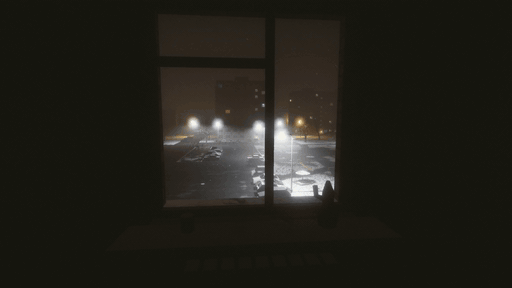
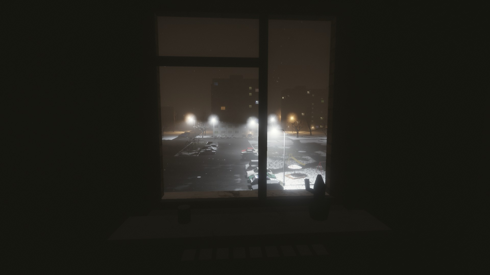
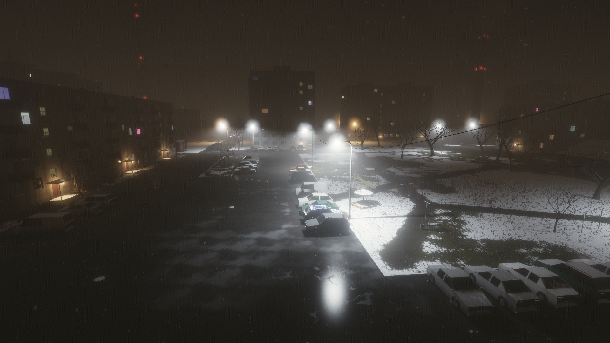
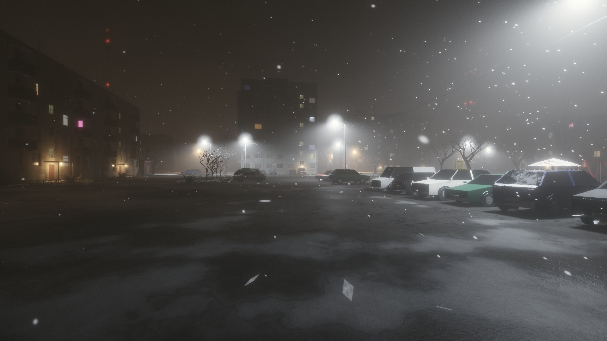
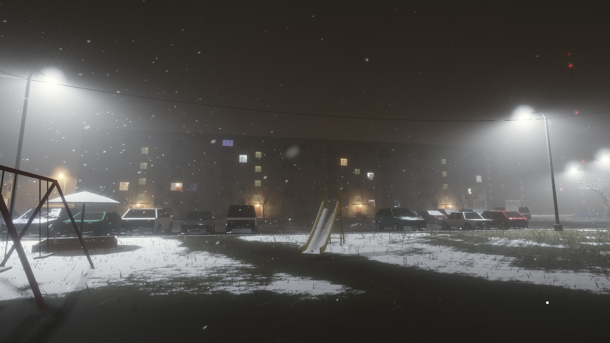
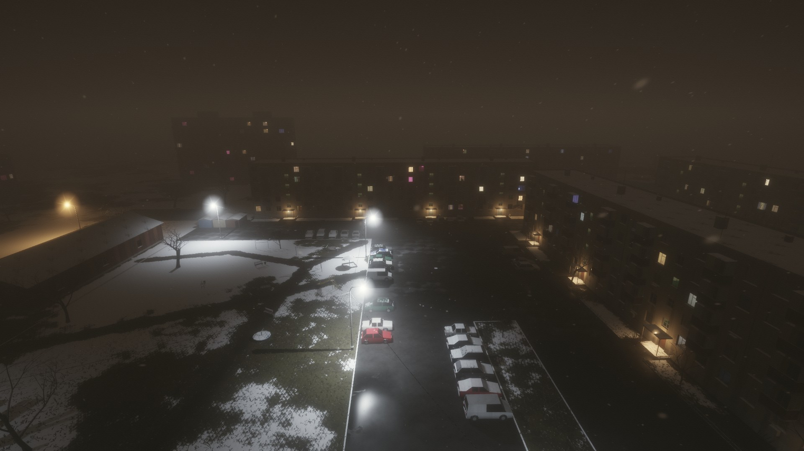
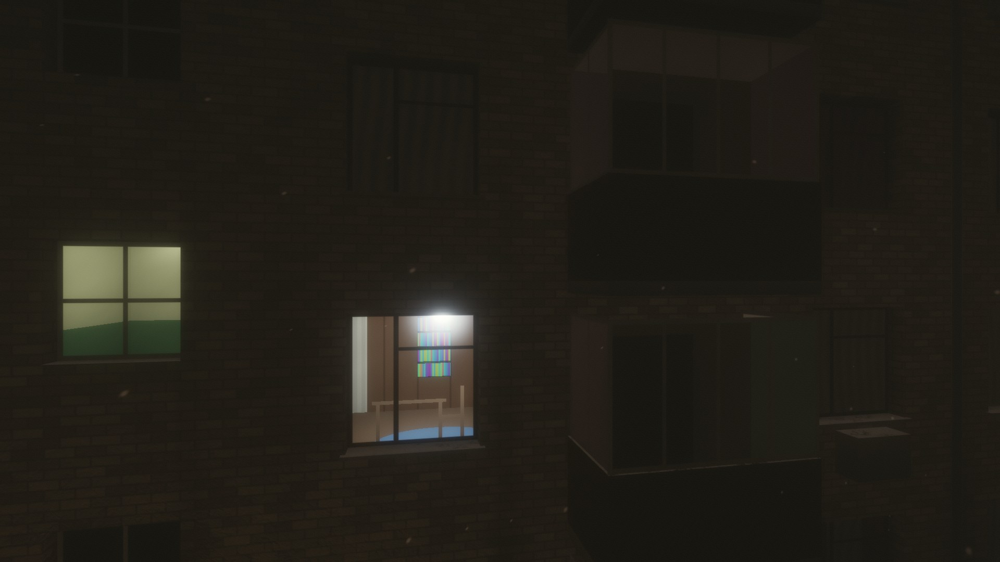
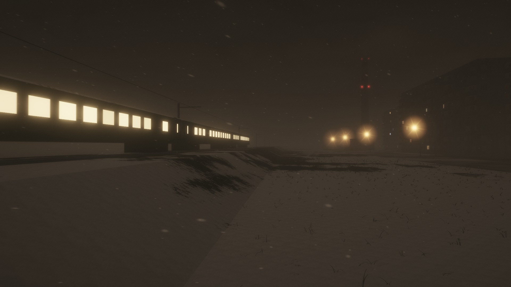

# Htone

A night courtyard of a post-Soviet housing estate, rendered in real time in the browser.
Late November, snow and wind that come and go, fog, a few lit windows.
You can stand in a dark kitchen by the window and look out over the yard, or fly out of the window and roam the scene.

[](assets/flight.mp4)

The clip above is a scripted camera move (the full video is `assets/flight.mp4`, without sound).

**Live demo: https://maksimgolub.com/demo/htone/**

Everything is drawn directly with **WebGPU**.
There is no game engine and no 3D library, and there is not a single image, model or sound file: the houses, cars, trees, the rooms behind the windows and the sound are all generated by code.
The whole scene is one `index.html` of about 310 KB.

| | |
|---|---|
|  |  |
|  |  |
|  |  |
|  | |

## Run

Open `index.html` in Chrome or Edge.
A browser with WebGPU is required.

## What is in the scene

- Five-storey brick houses and nine-storey panel blocks with balconies, entrances, canopies and antennas.
- About 4300 windows, each with its own room behind it: wallpaper, a carpet on the wall, a bookcase, curtains, tulle, a chandelier, a television, a flower on the sill.
- About one window in thirteen is lit, and some go dark or light up from time to time.
- The stairwell windows glow in columns.
- Twelve street lamps with halos, light cones in the fog and shadows; one lamp is faulty and flickers.
- Parked cars of five types, a playground, benches, a bin, garages, a transformer booth.
- Snow that lights up as it falls through the lamp light, a patchy snow cover, wet asphalt with puddles.
- The wind dies down to nothing and rises to a strong blow in a slow swell: trees, wires, swings, weeds, washing and the tear-off strips of the notices move with it, scraps of paper blow across the asphalt.
- The snowfall thins to a few flakes and thickens to a heavy fall on a slower swell of its own.
- A highway behind the houses: now and then a car, a box truck, a tractor with a trailer, a motorhome or an old small bus goes by.
- Once every three and a half minutes a train passes: in turn a passenger train with lit windows and a long freight train with tanks, goods wagons, coal and containers.
- A radio mast and a boiler-house chimney with red lights, steam from the chimney and from a manhole.
- A night sky over the haze: a cloud deck drifting with the wind, the moon and stars in the gaps, now and then the lights of an aeroplane.
- Lit windows show living rooms, bedrooms and kitchens: wallpaper, carpets, pictures, wall units with books, a television with people watching it, a gas stove with blue flames, plants and a radio on the sill.
- By every door an intercom glows, a plate gives the flat numbers, and the walls carry clean graffiti.
- A grocery and a chemist's on the highway with lit windows full of goods, two all-night kiosks at the ends of the estate, a bus stop with people waiting.
- Private wooden houses beyond the estate, with plank fences, kennels and spruces.
- Snowmen, tyre flower beds, concrete vases, arched lawn fences, a notice board, bollards, piles of shovelled snow, horizontal bars.
- People sitting on two roofs with their legs over the edge, two cars by the doors with the engine running.
- Loose snow runs low over the ground in the gusts.
- Every entrance is its own: its own door colour, a walkway out over the lawn, a trodden path to wherever its people go, notices with tear-off strips, icicles on the canopy, a wreath or a garland on some, a bicycle, a sled, a broom or a cat by the door.
- In the yards: a hockey box with a floodlight, an ice slide, a rocket climbing frame, a seesaw, sandboxes, a dominoes table, washing frozen on the line, a carpet on its bar, snow forts, a New Year tree with a garland, a dovecote, a heating main with cats on it, rowans with bullfinches, crows on the lamps.
- Garages, one of them open with a bulb, a man and a radio in it; an old car under snow; a motorcycle under a cover; a taxi waiting; a car whose alarm goes off now and then; an ambulance at a far door with its lights flashing.
- Somebody walks a dog, a drunk sings his way along the house, a janitor scrapes the snow, a courier rides by, people wait at the stop; a pack of stray dogs on the waste ground.
- Lit windows with a cat on the sill, a garland, a fridge open in a dark kitchen, a flat being done up, an aquarium, a computer; satellite dishes, fire ladders, things on the open balconies, somebody smoking.
- On the street: kiosks for newspapers, beer, shawarma and flowers, a payphone, a cash machine, a post office, road signs, a zebra with lights blinking yellow, billboards, a snow plough, a tractor and a police van on the highway now and then.
- Beyond the estate the town goes on for over a kilometre, out of sight in the haze until one flies there.
- To the west an old quarter of two-storey houses of the fifties round their courtyards, with sheds, woodpiles, old saloons, lindens along the street, a bakery and a beer kiosk.
- On the highway to the west a cafe for truck drivers, its lorries idling for the heater, a fuel canopy, drivers with their tea at the door.
- To the east the centre: a square with a monument and a big New Year tree, the administration with its flag flying in the wind, the police with a car's lights going, the fire station with an engine in its open bay, the hospital with its emergency entrance and ambulances, shops along the avenue.
- A night club on the square: its sign, glass blocks flashing with the dance floor, coloured lights over the door, bouncers, a queue, people smoking and talking outside, the music thumping through the walls.
- Across the river a park round a frozen lake, with alleys of lamps, a stopped ferris wheel, a bandstand, a fountain, a gazebo; four new towers in coloured panels with shops downstairs, cars of people with money, a modern playground.
- The forest all round the town; in it now and then a wolf, a fox, an arctic fox or a hare runs past, and one hears wolves howl far off, an owl, a fox screaming, branches cracking under the snow.
- Round the estate: a level crossing with its bell and lamps, rail signals, a power line, a school, a kindergarten, a church with a bell, a factory with a gas flare, a building site with a crane, a water tower, a telecom tower, a frozen river with fishermen's tents, a road bridge, the forest.
- Now and then a shooting star, and a salute far away that is heard a few seconds after it is seen.

## Controls

| Key | Action |
|---|---|
| W A S D | fly |
| mouse | look |
| Q / E | down / up |
| Shift | faster |
| 1-6 | viewpoints: at the window, in the car park, under a lamp, on the playground, on the roof, by the railway |
| Esc | menu |
| M | sound |
| H | statistics |

On a phone: hold a finger down to fly forward, drag it to turn, a second finger speeds you up.

You can fly out of the kitchen through the window and back in.
In the kitchen the street sound is muffled by the glass, a clock ticks and an old television plays; a cup of tea stands on the table and a kettle on the gas.

## Detail levels

| Level | What changes |
|---|---|
| High | the full scene |
| Medium | half the grass and snowflakes, a 2048 shadow atlas, fewer steps in the light haze |
| Low | a quarter of the grass and snowflakes, no anti-aliasing, simple shadows, coarser trees |

The resolution and the grass draw distance adjust themselves to hold 60 frames per second.
If a load crashed the tab, the next attempt starts one level lower.

## How it works

- The layout of the yard is written as tables in `source/src/world.js`: houses, lamps, lawns, car parks, trees; `source/src/town.js` places the small things, the paths from the doors and the town round the estate; `source/src/districts.js` lays out the districts, the streets, the park and the forest.
- The geometry is built at load time: walls with window openings, cars, trees, props.
- The rooms behind the windows are not built: the window shader traces the view ray into an imaginary box and draws whatever it hits.
- Lamp light is computed per pixel from a grid of "which lamps light this square", and the lamp shadows are baked once into a shared atlas.
- Light in the fog is a separate pass at half resolution, followed by bloom, a vignette, a tone curve and film grain.
- Snow, paper, steam and lamp glares are quads moved entirely by the GPU.
- Signs, graffiti, notices and the goods in the shop windows are painted once at load time with Canvas 2D into one decal atlas.
- The sound is synthesized with Web Audio and follows the same numbers as the picture: wind gusts, the trains, the highway, the aeroplane, the flickering lamp.
- Sounds of the yard are placed where they come from: music in the cars by the doors, radios, cooking and televisions behind some windows, whistling on the roofs, dogs, the transformer and the lifts humming, the roundabout creaking, the janitor's scraper, the taxi's engine, the alarm, the drunk's song, crows, the church bell, the crossing bell, drips off the icicles.

## Build

```
cd source
npm install
npm run build            # ../index.html, minified
npm run build:readable   # the same without minification
npm run build:dev        # ../dev.html with the development tools
```

All interface strings live in `source/lang.mjs`, one table per language; `source/build.mjs` bundles the sources and the strings into a single file.

In `dev.html` the F key starts a one-minute fly-through of the scene, and the B key runs the same fly-through as a performance benchmark.
An address such as `dev.html#p=3&t=45` opens viewpoint 3 at scene time 45 seconds without the menu; `cam=x,y,z,tx,ty,tz` aims the camera freely and `hold=1` fixes the resolution.
For deterministic frame capture, `window.dev.halt()` stops the page's own frame loop and `await window.dev.step(dt, x, y, z, tx, ty, tz)` advances the scene by a fixed time step, aims the camera and renders one frame.
The video in `assets/` was captured that way.

| File | What is in it |
|---|---|
| `source/src/quality.js` | the detail level |
| `source/src/math.js` | random numbers, noise, the mesh builder |
| `source/src/props2.js` | yard props and people: snowman, tyres, vases, fences, bus stop, people sitting and standing |
| `source/src/props3.js` | highway vehicles, freight wagons, private houses, shop pavilions, kiosk, spruce |
| `source/src/props4.js` | yard, street and railway props: hockey box, playground things, garages, signs, lights, ladders, icicles |
| `source/src/props5.js` | police van, ambulance, snow plough, tractor, people walking, dogs, birds, rowan, far buildings |
| `source/src/props6.js` | the buildings of the centre, the club, the cafe, the park, fire engine, police car, forest animals, people out at night, forest trees |
| `source/src/world.js` | the yard layout and everything built from it |
| `source/src/town.js` | the small things of the estate, the entrances, the paths, the town round it |
| `source/src/districts.js` | the districts round the estate, their streets and lamps, the park, the forest and its animals |
| `source/src/shaders.js` | WGSL shaders |
| `source/src/atlas.js` | the decal atlas: graffiti, plates, signs, notices, goods |
| `source/src/main.js` | rendering, camera, controls, menu |
| `source/src/audio.js` | sound |
| `source/src/dev.js` | development tools (dev build only) |
| `source/template.html` | the page and its styles |
| `source/lang.mjs` | all interface strings, one table per language |
| `source/build.mjs` | the build into one file per language |

What is easiest to tweak:

- `EXPO` and `RAYS` in `main.js`: exposure and the strength of the fog glow.
- `FCOL` and `SIG` in `shaders.js`: fog colour and density.
- `POLES` in `world.js`: the street lamps.
- The `.075` threshold in the window shader in `shaders.js`: the share of lit windows.
- `TRAINP` in `main.js` and `ROADP` in `world.js`: how often the trains and the highway vehicles pass.

## Performance

A 60 second fly-through at 2560x1440 on the High level, Nvidia RTX 50 series graphics card: 5.7 ms per frame on average, GPU time 4 to 10 ms along the route.

## License

MIT, see `LICENSE`.
